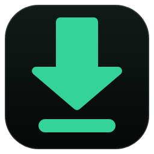
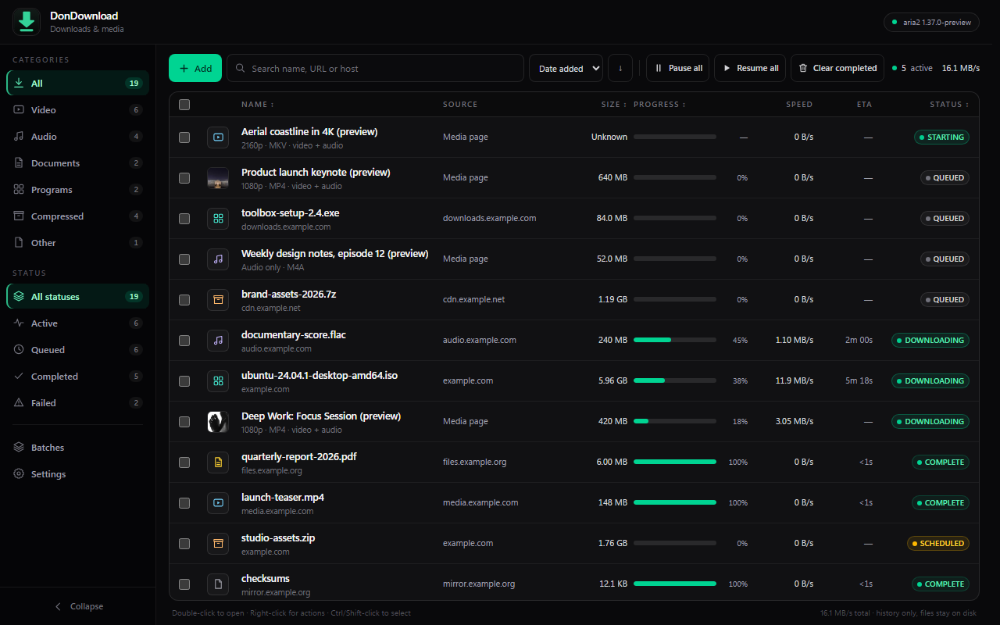
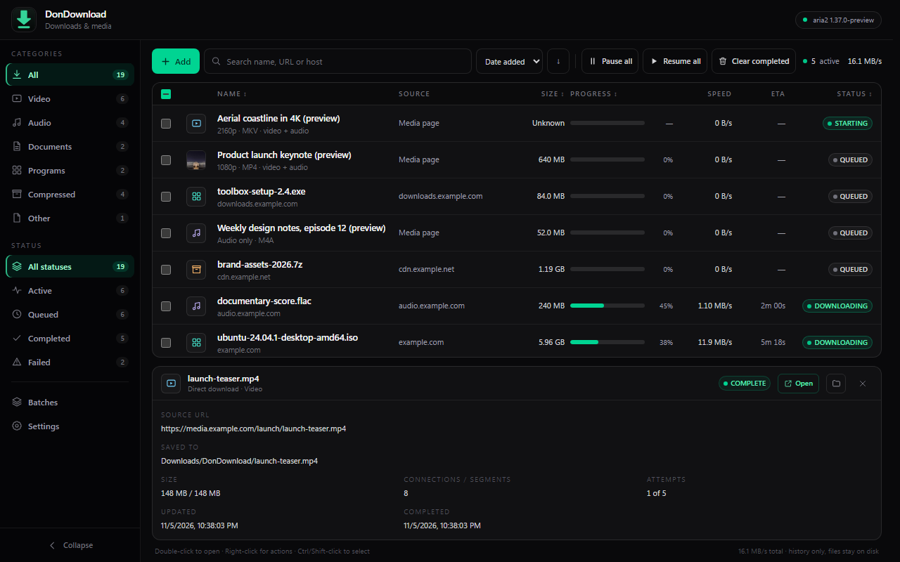
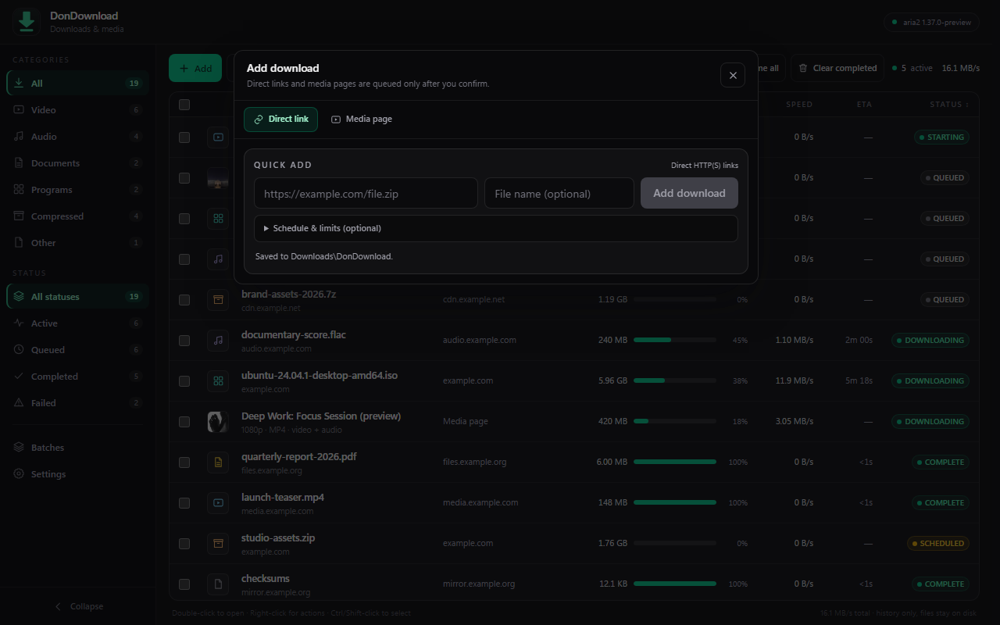
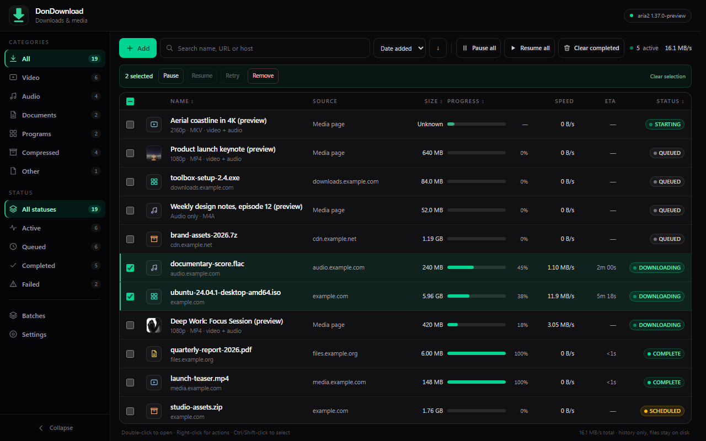
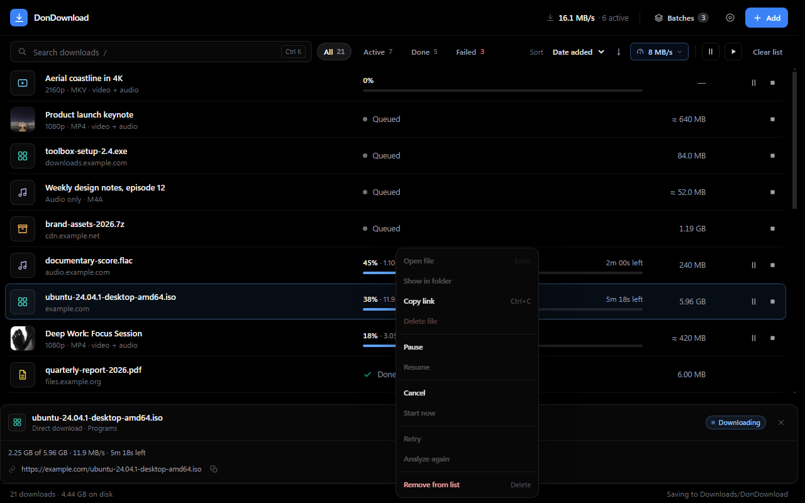
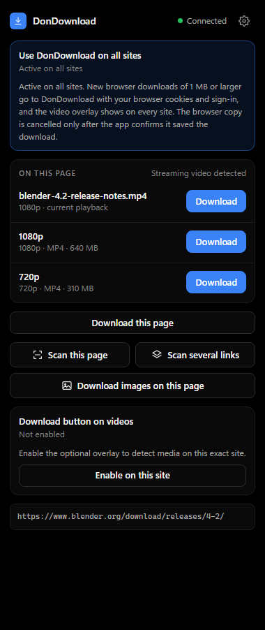

<div align="center">



# DonDownload

**A fast, lightweight download manager for Windows.**

[](https://github.com/AVNNT/dondownload/releases/latest)
[](LICENSE)




</div>

## Features

|  |  |
| --- | --- |
| ⚡ **Fast** | aria2 under the hood, up to 16 connections per file |
| 🌐 **Browser hand-off** | Chrome, Edge, Brave, Helium, Firefox and Zen send downloads straight to the app |
| 🎬 **Video downloads** | Paste a video page, pick the quality (yt-dlp + FFmpeg) |
| 🔎 **Link scanner** | Paste forum or page links, get every download on them |
| 🪶 **Light** | ~1 MB when idle in the tray |
| 🔒 **Private** | No accounts, no telemetry, signed updates |
| 📁 **Save to** | Pick any folder for a single download in the Add dialog |

<table>
  <tr>
    <td width="50%"><p align="center">Details for every download</p></td>
    <td width="50%"><p align="center">Paste links, check, download</p></td>
  </tr>
  <tr>
    <td width="50%"><p align="center">Act on many at once</p></td>
    <td width="50%"><p align="center">Everything one right-click away</p></td>
  </tr>
</table>

## Install

1. Download **`DonDownload-1.3.0-x64-setup.exe`** from [Releases](https://github.com/AVNNT/dondownload/releases/latest).
2. Run it. No admin rights needed.

> [!NOTE]
> The installer isn't code-signed yet. If Windows shows *Windows protected your PC*, click **More info → Run anyway**.

## Browser extension (optional)



Sends downloads, pages and videos from your browser to the app.

**Chrome · Edge · Brave · Helium**
1. Download and extract `dondownload-extension-chromium-1.3.0.zip`
2. Open `chrome://extensions`, turn on **Developer mode**
3. **Load unpacked** → pick the folder

**Firefox · Zen (140+)**
1. Download `dondownload-extension-firefox-1.3.0.xpi`
2. Open the file (or drag it into a Firefox window) and confirm **Add**. It is
   signed by Mozilla, so it stays installed after a restart.

The app connects to the extension by itself.

<br clear="right">

## More

<details>
<summary><b>Extension details</b></summary>

#### Chrome, Edge, Helium and Brave

1. From the same GitHub release, download `dondownload-extension-chromium-1.3.0.zip`
   and extract it to a folder you keep (don't delete it while you use the
   extension).
2. Open `chrome://extensions` (Edge: `edge://extensions`).
3. Turn on **Developer mode**.
4. Click **Load unpacked** and select the extracted folder.
5. Start DonDownload once, then open its **Settings → Browser extension** panel
   to see the connection state for each browser.

The extension has a fixed ID (`mikinloaillialkiannpcejdbmfbljhm`), so the folder
can be moved to another location without re-registering.

#### Firefox and Zen (140 or newer)

1. Download `dondownload-extension-firefox-1.3.0.xpi` from the same release.
2. Open the file (double-click, or drag it into a Firefox window) and confirm
   **Add**. The `.xpi` in releases is signed by Mozilla through
   addons.mozilla.org, so Firefox 140+ installs it permanently: it stays
   installed after a restart and updates like any other add-on.

Developer note: to try local changes, open
`about:debugging#/runtime/this-firefox`, choose **Load Temporary Add-on** and
pick `manifest.json` from the `extension/` folder yourself. A build from source
is unsigned, so Firefox only keeps it until the browser restarts (Firefox
Developer Edition or Nightly accept it with `xpinstall.signatures.required` set
to `false` in `about:config`).

The add-on uses the fixed ID `dondownload@dondownload.app`, which the desktop
app registers automatically.

#### What it does

- **Send this page** from the toolbar popup, or right-click a link →
  **Download with DonDownload**. Success is reported only after the app has
  accepted the job.
- **Automatic file hand-off.** Ordinary file downloads are passed to the app and
  the browser's copy is cancelled only after the app has confirmed a durable
  record and a size/type check. Anything unclear (sign-in, POST, unusual
  metadata) is left to the browser.
- **Media detection.** On normal http/https sites the extension lists the media
  files and HLS/DASH manifests it sees in the tab, so you can queue one with a
  click.
- **Optional video overlay.** Off by default; enable it per site to get a small
  **DD** button on a playing video with the qualities that player really used,
  plus an explicit **Find qualities** analysis through yt-dlp.

The extension never blocks or rewrites your browsing. `webRequest` and `cookies`
are optional permissions that are requested only when you use a feature that
needs them (media size evidence and per-site cookie opt-in).

</details>

<details>
<summary><b>Updates</b></summary>

DonDownload checks GitHub Releases at most once every 24 hours (the setting is
on by default; **Check now** is available too). A release is only offered when:

- its tag is a strictly newer `vX.Y.Z` version,
- it contains `DonDownload-<version>-x64-setup.exe`, `SHA256SUMS.txt` and
  `SHA256SUMS.txt.sig`,
- the Ed25519 signature over `SHA256SUMS.txt` verifies against the public key
  built into the app, and the installer's SHA-256 matches that signed list.

The update is downloaded into the app's own data folder and installs only when
you click **Restart and install**. It refuses to start while a download or media
job is still running.

</details>

<details>
<summary><b>Privacy</b></summary>

DonDownload has no accounts, no telemetry, no analytics and no crash reporting.

What leaves your machine:

- **Your downloads.** aria2, yt-dlp and FFmpeg connect to the servers you asked
  them to download from, as any downloader does. Pages fetched by the Smart Link
  Scanner are requested from their own sites.
- **The update check.** Once a day, `api.github.com` (and, if an update exists,
  GitHub's release download hosts) is asked for the latest release. The request
  carries a `DonDownload/<version>` user agent and no cookies or credentials.
- **Optional helper downloads.** yt-dlp can update itself and YouTube jobs can
  fetch a pinned Deno runtime; both come from GitHub releases and are checked
  against published SHA-256 sums.

What stays local: history in `%APPDATA%\dondownload\downloads.sqlite3`, settings,
the loopback address the extension uses to reach the app, and the native
messaging registration. The app does not log download URLs. URLs are stored in
the local history because retry and resume need them; query strings can carry
site-specific tokens, and the database is protected by your Windows user
profile's permissions rather than by application-level encryption.

Logs stay local too: `%APPDATA%\dondownload\logs` keeps redacted text only
(host names instead of links, `%USERPROFILE%` instead of your profile path), and
they are shared with anyone only if you paste them into a report.

The desktop bridge the extension talks to listens only on `127.0.0.1` with a
random port and a fresh bearer token per launch, and accepts nothing but a URL
to download.

</details>

<details>
<summary><b>Build from source</b></summary>

Requirements: Windows 10/11 x64, Node.js 24+, npm 10+. For the extension and the
installer you also need the .NET Framework 4.x C# compiler (`csc.exe`), which
ships with Windows.

```powershell
npm ci
npm run dev
```

Useful scripts:

```powershell
npm run typecheck   # TypeScript, main/preload and renderer
npm run lint        # ESLint
npm run test:fast   # hermetic unit/component tests
npm test            # full Vitest suite
npm run build       # typecheck + production build
npm run build:native-host   # native messaging host (.exe)
npm run build:tray-stub     # native tray stub (.exe)
npm run build:installer     # Windows x64 NSIS installer in dist/
```

A development checkout does not bundle the third-party tools. Install aria2
(for example `winget install aria2.aria2`) or point the app at a binary with
`DONDOWNLOAD_ARIA2_PATH`; yt-dlp and FFmpeg are only needed for media
downloads. If a required tool is missing, the app says so instead of failing
silently. Building the installer needs none of them: `npm run build:installer`
downloads the pinned, SHA-256 verified aria2, yt-dlp and FFmpeg release
archives from their official upstream URLs. See
[docs/release-readiness.md](docs/release-readiness.md) to build your own or run
a fork with its own update feed.

Further reading:

- [Browser hand-off and the native host](docs/automatic-browser-handoff.md)
- [Media capture and the video overlay](docs/media-capture-progressive.md)
- [Media tools and their licenses](docs/media-tools.md)
- [Smart Link Scanner](docs/smart-link-scanner-browser-only.md)
- [Installer packaging](docs/installer-packaging.md)
- [Performance and memory](docs/performance.md)
- [Testing workflow](docs/testing-workflow.md)
- [Smoke test](docs/smoke-test.md)

Contributions are welcome; see [CONTRIBUTING.md](CONTRIBUTING.md). Please report
security issues privately, as described in [SECURITY.md](SECURITY.md).

</details>

<details>
<summary><b>License</b></summary>

DonDownload's own source is released under the [MIT License](LICENSE).

The installer also ships third-party programs that keep their own licenses:
aria2 (GPL-2.0-or-later), yt-dlp (Unlicense, plus bundled third-party licenses)
and the Gyan FFmpeg essentials build (GPL-3.0-or-later). Deno (MIT) is not
bundled; it is downloaded on demand for some YouTube jobs. See
[third-party/NOTICE.md](third-party/NOTICE.md) for the inventory,
[third-party/licenses/](third-party/licenses/) for the license texts and
[docs/licensing-release-audit.md](docs/licensing-release-audit.md) for the
release audit. Those notices travel with the installer. The MIT license for
DonDownload does not replace the terms of any bundled binary.

</details>
